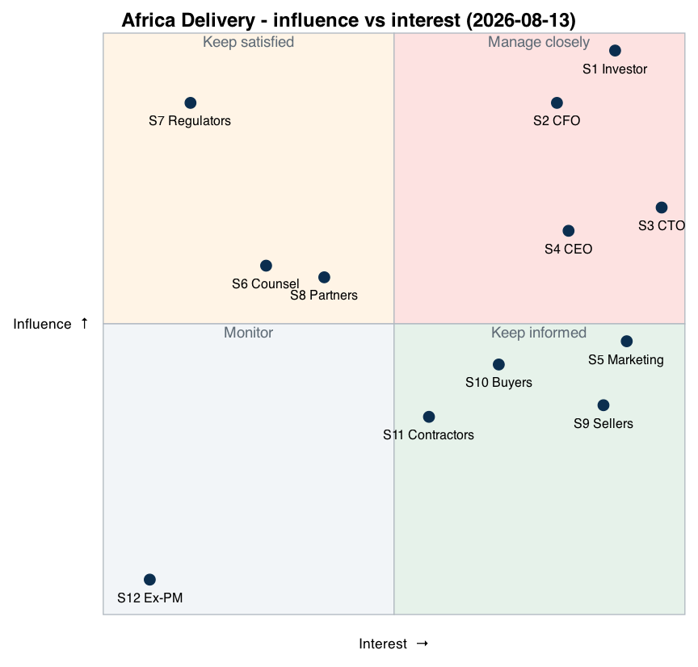

# Stakeholder Matrix

Date: 2026-08-13 · Author: Solution Architect (deputy CTO candidate) · Sources legend: [README](../README.md#sources)

## Who actually decides

| Decision class | Final say | Why (source) |
|---|---|---|
| Launch date, markets, definition of success | **Investor (K. Orlov)** | Sole shareholder; "15 Oct. Not negotiable" (A1, A7) |
| Any spend, ceiling of $5k/mo, items > $500 | **CFO (A. Weber)** — delegated veto | "Anna will show you the numbers, don't argue with Anna" (A1); signs every invoice > $500 (A6 p.2) |
| Technology inside the budget | **CTO (R. Menon)**, SA proposes | "Technology is your zone" (A1); SA is deputy CTO |
| MVP scope (what ships 15 Oct) | **CEO (M. Lefebvre)** as interim product owner | PM left (A4); CEO asked for a clear R1 cut (A1) |
| Personal data, payments licensing | **Law → external counsel → Board** | Regulator sanctions (A3 p.1–4); investor's own red line "minister calls" (A1, A7) |

**Conflict priority (top wins):** 1 Law & regulators → 2 CFO cash ceiling → 3 Investor date & success criteria → 4 CEO scope → 5 CTO technology preferences → 6 Marketing promises. The CFO ranks above the investor's wish list because the investor delegated the money veto to her explicitly (A1); law ranks above everyone because the investor's own success criterion is "no minister calls about Nigerian data" (A1).

## Matrix

| # | Stakeholder | Interests (what they want) | Influence 1–10 | Interest 1–10 | Priority in conflict | Strategy | Preferred communication |
|---|---|---|---|---|---|---|---|
| S1 | K. Orlov — investor, sole shareholder | Launch 15 Oct, "never down", 40% share in 3 yrs, cheap, data in country, same-day seller payouts (A1, A7) | 10 | 9 | 3 (date, success) | Manage closely | One page, English, "solution not problem", before his Thursday flight (A1) |
| S2 | A. Weber — CFO | Survive month 7; $5k/mo cap; no prepayments; payments ≤ 2.5% GMV; TCO incl. people (A6) | 9 | 8 | 2 | Manage closely | Written numbers: TCO, cost per order, cost of error; quote + named alternative for every item > $500 (A6) |
| S3 | R. Menon — CTO, my line manager | Not "the CTO whose platform fell on launch night"; K8s/Istio/Kafka, Go, Oracle, build logistics & payments (A5) | 7 | 10 | 5 | Manage closely, co-author | ADR drafts 1:1 **before** group meetings (A5 asks for it); Go/K8s kept where they pay off |
| S4 | M. Lefebvre — CEO, ex-Jumia | Clear R1 scope; realistic plan ("Jumia took a year") (A1) | 7 | 8 | 4 | Manage closely, ally | Weekly scope review; decision log; uses his market knowledge (only person with African e-com experience) |
| S5 | S. Almeida — Head of Marketing | Promises already printed: 1M buyers/month, same-day delivery, 5 languages, live streams 17 Oct, SMS to 410k numbers (A2) | 5 | 9 | 6 | Keep informed, negotiate promises | Launch checklist: "deliverable / deliverable differently / not deliverable" per promise |
| S6 | A. Nwosu — external counsel (Lagos), hourly | Not liable for early decisions; 4–6 weeks for specifics (A3) | 6 | 3 | 1 (as voice of law) | Keep satisfied | Batched, closed written questions to cut billable hours |
| S7 | Regulators: NDPC (NG), ODPC & CA (KE), Information Regulator (ZA), CBN/CBK | Lawful processing, local storage, consent, takedown (A3, case) | 9 | 2 (until incident) | 1 | Keep satisfied | Through counsel; early registration as advised (A3 p.1) |
| S8 | Payment & logistics partners: Safaricom M-Pesa, Flutterwave, Paystack, Sendbox, Sendy, Meta (WhatsApp), SMS/USSD aggregator | KYB, volume, compliant integration | 6 (gate go-live) | 4 | 2 (contracts are hard constraints) | Keep satisfied | Commercial + technical onboarding tickets started week 1 |
| S9 | Sellers (SMB, WhatsApp/USSD, part offline) | Customers, money same day, no complex onboarding (A1, case) | 4 | 9 | 4 | Keep informed, involve | WhatsApp; 10–15 interviews in Lagos (blocked by investor in A1 — re-proposed in open questions) |
| S10 | Buyers (urban 22–40 on < $150 Android; rural via USSD/SMS) | Cheap, trusted, fast, low data use (A2) | 4 (individually; aggregated via S4) | 7 | — (served via S1/S4) | Keep informed | App analytics, NPS, support tickets |
| S11 | 6 contractors (hiring freeze to Dec) | Feasible scope, clear ownership, sane on-call | 5 | 6 | — | Keep informed | Daily stand-up, ADRs, runbooks |
| S12 | T. Bradley — ex-PM (left 4 Aug) | — (legacy feature list A4) | 1 | 1 | — | Monitor | None; list treated as input, not scope |

## Influence / interest diagram

Source: [stakeholder-influence-interest.puml](stakeholder-influence-interest.puml) (PlantUML, embedded DOT with pinned coordinates).

## Assumptions

- AS-1: The "Board" quoted by the CTO (A5: on-prem must stay on the table) is the investor himself, as he is the sole shareholder; to be confirmed (open question Q6).
- AS-2: The CEO accepts the interim product-owner role until a PM is hired after the freeze (A6 p.5).
- AS-3: The CEO's ex-Jumia background brings no non-compete restrictions on the Nigerian/Kenyan market.
