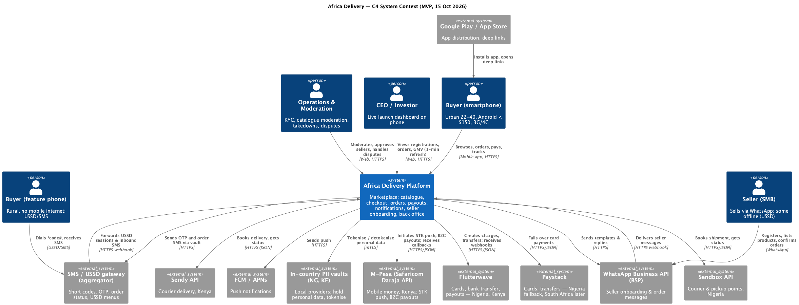

# Architecture Vision — Africa Delivery

Version 1.0 · 2026-08-18 · Owner: Solution Architect, approved by CTO · Inputs: Task1, [options-comparison.md](options-comparison.md), [ADR-001](adr-001-architecture-style.md), [tco-model.xlsx](tco-model.xlsx)

## 1. Problem and business context

Africa Delivery launches a low-price, multi-category marketplace in Nigeria and Kenya on **15 October 2026**, then South Africa, 5 countries in 12 months and 12–15 in three years (A1, A7, case). Paid media ($180k) is already running (A2). Money is tight: ≤ $5k/month infrastructure, 9 months runway, six contractors (A6). Buyers are mobile-only on cheap Android phones and 3G; 30–40% of the market is reachable only via USSD/SMS (A2). Personal data must stay in its country (A3, A7). The competitors' weakness is trust — counterfeits and failed deliveries (A2).

## 2. Goals and success measures

| Horizon | Goal | Measure |
|---|---|---|
| 15 Oct 2026 (MVP) | "People buy, sellers get paid, nothing breaks, no minister calls" (A1) | 100 sellers / 5,000 SKU live; ≥ 95% of paid orders delivered; seller payout same day after delivery; checkout availability ≥ 99.95%; zero personal data of NG/KE subjects stored outside their country in clear form |
| Month 12 | 5 countries, > 1M users, B2B, seller analytics, track & trace, returns | ≤ $1.25 cost per order at 100k orders/month; IT cost ≤ 4% of GMV |
| Month 36 | 12–15 countries, 40% share | Country onboarded in ≤ 6 weeks as a new "cell" from the same code |

## 3. Stakeholder concerns addressed

Investor — date, availability, sovereignty (§6, §8). CFO — TCO, cost per order, cost of error (§9). CTO — cloud-native, Go, growth to 10M (§6, §7). CEO — a releasable scope (§4). Marketing — which promises are kept and how (§4). Counsel/regulators — residency, consent, takedown (§6). Details: [Task1/stakeholder-matrix.md](../Task1/stakeholder-matrix.md).

## 4. Scope

**In MVP (9 of the PM's 29 features, 7 of them cut down; A4):** catalogue (#1, simplified), search with typo tolerance in EN (#2, reduced), payments M-Pesa + Flutterwave (+ Paystack fallback, cash on delivery via courier) (#11, reduced), pickup-point and courier delivery via partners (#19 without video), USSD/SMS ordering (#24), Flutter app for Android + iOS (#25, reduced), minimal back office: KYC, moderation, takedown, refunds (#26), CEO dashboard (#28), seller onboarding via WhatsApp (#8). Plus what the PM missed: consent ledger, PII vaults, observability.

**Deliver differently:** live shopping → TikTok/Facebook Live with deep links (A2 p.7); "instant refund" → initiated instantly, settled on the payment rail; 5 languages → UI strings in EN, FR, Swahili, Hausa, Yoruba via translation files, catalogue in EN; launch SMS blast → opt-in call to action.

**Not doing (and until when):** crypto loyalty — evaluate after month 12, as the investor asked (A1, A5); BNPL with own scoring and wallet — needs licences (A3 p.4), not before month 12; own logistics engine and warehouses — month-12 review (A4 notes); dynamic pricing by scraping Jumia — legal risk, not planned; native live streaming, voice search, AI recommendations, ML anti-fraud — month 6–12 by data volume. Full list and criteria: Task5 roadmap.

## 5. Architecture principles

1. **Buy commodity, build differentiation.** We build checkout, catalogue and WhatsApp/USSD seller onboarding; we partner for payments, logistics, messaging.
2. **Late binding.** Every decision that lawyers or traffic will inform later is a configuration, not code (country cell placement, region, extraction of modules).
3. **Portability via open standards, not self-hosting.** Kubernetes, PostgreSQL protocol, Redis protocol, OpenTelemetry, Terraform — runs on GCP, AWS, Azure or on-prem.
4. **Degrade, don't fail.** Catalogue from cache, notifications queued, payments fail over between PSPs.
5. **Personal data stays home.** Clear-text PII of NG/KE subjects lives only in in-country vaults; the shared platform sees tokens.
6. **Mobile-first, megabyte-aware.** Offline cache in the app, progressive images, API payloads < 50 KB per screen.

## 6. Target solution overview

- **Clients:** one Flutter app (Android + iOS) with local cache; web pages for deep links; USSD/SMS menus via an aggregator; WhatsApp conversational flows for sellers; web back office; CEO launch dashboard (Grafana on business metrics, 1-min refresh, phone-friendly) and Metabase on a read replica for ad-hoc analytics (aggregated data only).
- **Core:** Go **modular monolith** (ADR-001), ten modules with schema-per-module and transactional outbox; deployed as `api`, `worker`, `channels` on managed Kubernetes, **GCP africa-south1 (Johannesburg), 3 zones**; managed PostgreSQL HA and Redis; Cloudflare CDN/WAF with edge in Lagos and Nairobi.
- **Sovereignty:** per-country **PII vault** (Lagos, Nairobi; local providers) that tokenises personal data and sends SMS/courier requests with clear data from inside the country (Task4 ADR-003).
- **Resilience:** pilot-light DR in AWS af-south-1 (Cape Town) with cross-provider backups (Task4 failover plan); PSP failover Flutterwave ↔ Paystack in Nigeria.
- **Integrations:** M-Pesa Daraja, Flutterwave, Paystack, Sendbox, Sendy, WhatsApp BSP, SMS/USSD aggregator, FCM/APNs.
- **Use cases:** [use-cases.png](use-cases.png).

## 7. Key decisions

| ADR | Decision | Traces to |
|---|---|---|
| [ADR-001](adr-001-architecture-style.md) | Modular monolith, partner integrations | C-01, C-02, C-08 |
| [ADR-002](../Task3/adr-002-caching-strategy.md) | Multi-layer cache (app, CDN, Redis) with TTL + event invalidation | C-01, C-10 |
| [ADR-003](../Task4/adr-003-data-residency.md) | Per-country PII vaults, pseudonymised core in ZA | C-03, C-04 |
| [ADR-004](../Task5/adr-004-payment-provider.md) | M-Pesa direct (KE), Flutterwave primary + Paystack fallback (NG) | C-07 |

## 8. Quality targets (detailed in Task3)

Checkout/payments availability 99.95% monthly; catalogue 99.95% with stale-while-revalidate; notifications 99.9% delivered ≤ 5 min; p99 API latency ≤ 800 ms server-side, first product on screen ≤ 2 s on 3G from cache; RPO ≤ 5 min / RTO ≤ 1 h for region loss, RPO 0 / RTO ≤ 2 min for zone loss. The investor's 99.99% is the month-12+ target with a cost trigger (GMV-at-risk > $1.5k/min, Task3).

## 9. Cost (from TCO model)

Cloud + SaaS **$4,100/month** in Year 1 (cap $5,000). 5-year direct TCO **$44.1M**, of which 72% are payment, SMS and logistics fees that scale with GMV, 11% payroll. Cost per order **$3.32 at launch → $1.25 at month 12**. Cost of error: building for 10M and getting 50k users wastes ≈ $1.04M; building small and growing to 10M costs ≈ $0.25M of extraction work.

## 10. Risks (top 5, full register in Task5)

Partner onboarding (KYB, WhatsApp verification) longer than 6 weeks; legal opinion changes data placement after 5–19 Sep; radio-driven launch burst; key-person dependency on CTO/SA with no local staff; logistics partner cannot meet "same day" in all promised zones.

## 11. Transition

Now (no system) → **MVP 15 Oct** (NG + KE, monolith, vaults) → **month 6** (ZA cell with POPIA consent, seller cabinet, track & trace, returns) → **month 12** (5 countries, B2B, first extracted services by trigger, 99.99% path if justified). Details: Task5 transition architecture.

## Assumptions

- AS-1 Launch load ≤ 100k MAU, 20k orders/month, 10× burst (Task1 canvas).
- AS-2 GCP africa-south1 offers GKE, Cloud SQL HA, Memorystore — verified in Task4 region comparison.
- AS-3 Counsel accepts pseudonymised processing outside Nigeria; otherwise the Nigerian cell moves fully to Lagos (ADR-003, ≤ 10 working days).
- AS-4 The CEO acts as interim product owner (Task1 Q4).
