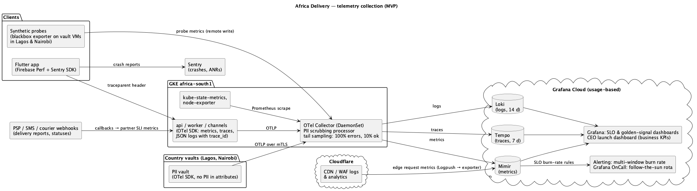

# Observability Strategy

Date: 2026-08-24 · Traces to: CN.OBS.01/02 (A5 attachment), NFR-23, SLO contracts in [slo/](slo/), A2 (live launch dashboard for the investor), A6 p.7 (no per-host APM licences).

## Principles

1. **Every alert maps to an SLO** — the on-call engineer is paged on error-budget burn, not on CPU.
2. **One pipeline, open standard** — OpenTelemetry SDK in Go and in the vaults; one Collector; the backend is replaceable (Grafana Cloud today, self-hosted Mimir/Loki/Tempo or any OTLP vendor tomorrow).
3. **No PII in telemetry** — the Collector drops/ hashes `phone`, `name`, `address`, `email` attributes and log fields; vault telemetry carries tokens only (ADR-003).
4. **Usage-based cost** — Grafana Cloud Pro ≈ $200/month at launch (TCO Block 2), Sentry Team, no per-host APM.

## Four golden signals per service

| Service / module | Latency | Traffic | Errors | Saturation |
|---|---|---|---|---|
| Catalogue (`api`) | `http_server_duration_seconds` p50/p99 per route; edge TTFB | rps at edge and origin; cache hit ratio (CDN, Redis) | 5xx ratio at edge/origin | Pod CPU vs request; Redis memory; DB connections in use |
| Checkout & payments (`api`) | Checkout p99; PSP call duration per `psp`; time to terminal payment state | Payment intents/min per country & PSP | Failed intents (non-business), breaker state, reconciliation mismatches | Outbox backlog; DB CPU/IO; PSP rate-limit headroom |
| Notifications (`worker`) | Enqueue → DLR seconds by `type` (otp, transactional) | Messages/min per channel & provider | Undelivered / rejected DLRs; sender-ID blocks | Queue depth and age; provider throughput quota |
| Channels (`channels`: USSD, SMS-in, WhatsApp) | USSD step response time (aggregator times out at ≈ 3 s) | Sessions/min per country | Session drop ratio | Webhook concurrency vs limit |
| PII vaults (Lagos, Nairobi) | Tokenise/detokenise p99 | Calls/min | Error ratio, mTLS failures | VM CPU, disk, replication lag |
| Platform | Node pod-start time | — | CrashLoopBackOff, failed probes | Node/cluster capacity, HPA at max |

## Metrics → SLI mapping

| SLI (contract) | Metric expression (Prometheus) |
|---|---|
| Catalogue availability ([catalog.md](slo/catalog.md)) | `sum(rate(edge_requests_total{route=~"catalog|search",status!~"5.."}[5m])) / sum(rate(edge_requests_total{route=~"catalog|search"}[5m]))` |
| Catalogue latency | `histogram_quantile(0.99, sum by (le) (rate(http_server_duration_seconds_bucket{route=~"catalog.*"}[5m]))) < 0.3` |
| Payment availability ([payments.md](slo/payments.md)) | `payment_initiations_total{outcome=~"accepted|declined_business"}` / all non-client-error |
| Payout timeliness | `histogram_quantile(0.99, payout_initiation_delay_seconds_bucket) < 14400` |
| Notification delivery ([notifications.md](slo/notifications.md)) | `notification_delivery_seconds_bucket{type="transactional",le="300"}` / `_count` |

**Alerting:** multi-window, multi-burn-rate (Google SRE workbook): page when 2% of the 28-day budget burns in 1 h (14.4×, 5-min confirm) or 5% in 6 h (6×); ticket when 10% in 3 days. Partner-specific alerts (PSP success rate < 90% for 5 min, SMS DLR < 80%) page the integration owner. Rota in Grafana OnCall, follow-the-sun across contractors' time zones (Task5 org structure).

## Logs

Structured JSON (`zap`), fields: `ts, level, service, module, country, trace_id, span_id, order_id, event`. Retention 14 days in Loki; audit events (consent changes, takedowns, refunds, admin actions) go to the database audit table (365 days, CN/legal), not to logs. Sampling: no sampling for `warn`+, 20% for `info` above 500 lines/s.

## Distributed tracing

W3C `traceparent` from the Flutter app through Cloudflare to `api`, into the outbox (trace context stored with the event) and to `worker`, vault and partner calls (span per PSP/courier request with `psp`, `http.status_code`, retry count). Tail sampling in the Collector: 100% of error/slow (> 1 s) traces, 10% of the rest; retention 7 days. Exemplars link latency histograms to traces.

## Business telemetry — CEO launch dashboard

Counters emitted by the monolith: `registrations_total{country,channel}`, `orders_total{country,channel}`, `gmv_amount_total{currency}`, `payouts_total`. Grafana dashboard, 1-minute refresh, mobile layout, aggregated only (no PII) — satisfies the investor's live dashboard request (A2) and PM feature #28 (A4).

## Collection scheme

Source: [observability.puml](observability.puml).

## Tools

| Need | Tool | Why |
|---|---|---|
| Instrumentation | OpenTelemetry Go SDK, Firebase Performance (app), Sentry (crashes) | Open standard; free SDKs |
| Collection | OTel Collector (DaemonSet), blackbox exporter on vault VMs (synthetic probes from Lagos & Nairobi) | One pipeline, PII scrubbing, real in-country vantage points at no extra cost |
| Storage & UI | Grafana Cloud: Mimir, Loki, Tempo, Grafana, OnCall | Usage-based ≈ $200/mo; same stack as the CTO's list (A5) without operating it |
| SLO management | OpenSLO specs in Git → Sloth-generated Prometheus rules | SLOs as code (CN.ADL.04) |
| Load & chaos | k6 (weekly from Sep 21), Chaos Mesh game-days | Verifies QAS-03/04 and FMEA actions |

## Assumptions

- AS-1 Grafana Cloud data location (EU) receives no personal data thanks to Collector scrubbing; verified by weekly DLP scan (NFR-14). If counsel objects, the backend moves to self-hosted LGTM in GKE (+ ≈ $300/mo) without code changes.
- AS-2 Firebase Performance is used with anonymous installation IDs only.
