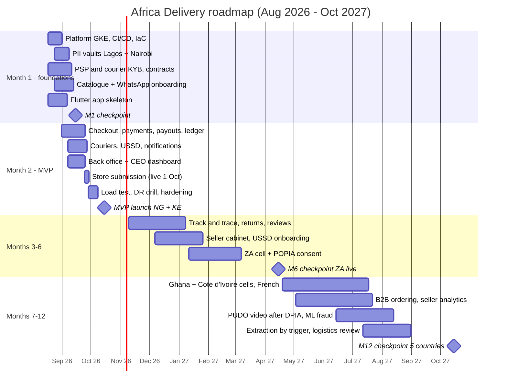

# MVP Roadmap

Date: 2026-08-28 · Constraints: 8 weeks, $5k/month, 6 contractors, hiring freeze to December (A6) · Rendered Gantt: [roadmap.png](roadmap.png) (source [roadmap.puml](roadmap.puml)); the Mermaid version below renders on GitHub.

## Four checkpoints

| Checkpoint | Scope (done = demonstrable) | Team | Infra (cloud + SaaS) |
|---|---|---|---|
| **M1 — 15 Sep 2026** (foundations) | GKE + Cloud SQL + CI/CD + ArgoCD; vaults in Lagos and Nairobi; catalogue with 30 pilot sellers onboarded via WhatsApp; M-Pesa and Flutterwave in sandbox, KYB submitted; app skeleton with offline catalogue; counsel's opinion received → ADR-003 confirmed | 6 contractors + CTO + SA; CEO as product owner | ≈ $2,600/mo (dev + staging, vaults, no prod scale) |
| **M2 — 15 Oct 2026** (MVP, NG + KE) | 9 of 29 PM features (below): checkout with M-Pesa/Flutterwave (+ Paystack standby, COD), courier/pickup via Sendbox & Sendy, USSD ordering, SMS/WhatsApp notifications, buyer account, back office (KYC, moderation, takedown, refunds), CEO live dashboard; 100 sellers / 5,000 SKU; store pages live 1 Oct; DR drill passed | Same 6 + CTO + SA; launch war-room in Lagos and Nairobi (2 contractors on site for 2 weeks) | **$4,100/mo** (≤ $5,000 cap) |
| **M6 — 15 Apr 2027** (ZA live) | ZA cell with POPIA consent ledger; seller web cabinet (basic); track & trace from courier webhooks; returns & refunds self-service; ratings & reviews; flash sales with stock reservation; USSD seller onboarding; full UI localisation | 6 contractors + PM (hired Jan 2027 when freeze lifts) + ops team (CEO) | ≈ $6,500/mo (CFO cap period ends; each item > $500 approved, A6 p.2) |
| **M12 — 15 Oct 2027** (5 countries) | Ghana and Côte d'Ivoire cells (French); B2B ordering; seller analytics; PUDO video evidence (if DPIA positive); ML fraud scoring (bought); first module extraction **only if** ADR-001 triggers fire; decision on own logistics engine with 12 months of data | 10 engineers (+4 from Year-2 budget) + PM + CTO + SA | ≈ $10,800/mo (TCO Year-2 run-rate $9,800 + 2 vaults) |

## The PM's 29 features: what was cut and why

**Selection criterion (in order):** (1) without it a buyer cannot complete a purchase or a seller cannot get paid; (2) the law requires it; (3) it is explicitly in the MVP goals of the case. Everything else is ranked by value/effort and moved to M6 or M12; items that need a licence or carry legal risk are rejected. **Result: 9 of 29 in the MVP, 7 of them cut down; 10 at M6, 6 at M12, 4 rejected.**

| # | Feature (A4) | Decision | Criterion / note |
|---|---|---|---|
| 1 | Catalogue, unlimited categories/attributes | **MVP, reduced** | (1); 20 categories with fixed attribute sets |
| 2 | Full-text search, typos, 5 languages | **MVP, reduced** | (1) for 5,000 SKU; EN + trigram; languages at M6 |
| 3 | Voice search Swahili/Hausa | M12 | Low value/effort |
| 4 | AI recommendations | M12 | Needs data |
| 5 | Live streams with in-stream purchase | M12 (now: TikTok/FB Live + deep links) | C-11 cost |
| 6 | Buyer–seller chat with translation | M6 | Masked relay via WhatsApp |
| 7 | Ratings & reviews with photo/video | M6 | Trust, after first deliveries |
| 8 | Seller onboarding via WhatsApp | **MVP** | (1), case |
| 9 | Seller onboarding via USSD | M6 | MVP: ops-assisted onboarding |
| 10 | Seller cabinet with cohorts and forecast | M6 basic / M12 analytics | Case 12-month goal |
| 11 | Payments: all methods | **MVP, reduced** | (1); M-Pesa, Flutterwave, Paystack standby, COD (ADR-004) |
| 12 | BNPL with own scoring | Rejected | Credit licence (A3 p.4) |
| 13 | Multi-currency wallet, P2P | Rejected | E-money licence (C-07) |
| 14 | Crypto-token loyalty | Rejected for now; evaluate after M12 | Investor: "study, not for October" (A1) |
| 15 | Wheel of fortune | M6 (growth experiment) | Low effort, unproven value |
| 16 | Flash sales with stock reservation | M6 (launch week: fixed "deals" carousel) | Oversell risk |
| 17 | Dynamic pricing by scraping Jumia | Rejected | Legal/ToS risk |
| 18 | Live courier map, ETA to the minute | M6 (track & trace) | MVP: status SMS from partners |
| 19 | Pickup points with video at every handover | **MVP, reduced** | (1); partner pickup points, no video until DPIA (A4 note) |
| 20 | 30-day returns, instant refund | M6 self-service | MVP: refunds via back office (#26) |
| 21 | ML anti-fraud | M12 | No data; MVP rules |
| 22 | B2B mode | M12 | Case 12-month goal |
| 23 | Affiliate & referral programme | M6 | Needs consent tooling |
| 24 | Offline ordering via USSD/SMS | **MVP, reduced** | (3) case; reorder + featured items |
| 25 | PWA + native iOS + native Android parity | **MVP, reduced** | (1); one Flutter app, no PWA |
| 26 | Back office: moderation, KYC, disputes, refunds | **MVP, reduced** | (2) KICA, KYC (C-09) |
| 27 | Public GraphQL API | M12+ | No partners yet |
| 28 | Real-time executive dashboard | **MVP** | Investor's own success check (A2) |
| 29 | Dark theme | M6 | Cheap, no launch value |

Not in the PM's list but in the MVP: PII vaults and consent ledger (law), notifications routing (case), observability, DR.

## Assumptions

- AS-1 The CEO approves the cut at the Nairobi meeting (Task1 Q4).
- AS-2 PSP production keys by 2026-09-20 (risk R1).
- AS-3 Countries 4–5 are Ghana and Côte d'Ivoire (French requirement in the case); final choice by CEO at M6.
